# Tata CLiQ – Defect Management & Bug Reporting Standard

## 1. Overview
Defect management is the core discipline of software quality assurance. This document formalizes the defect reporting structure, severity/priority classification models, defect lifecycle states, and tracking guidelines for the Tata CLiQ manual testing project.

---

## 2. Standard Defect Report Attributes
Every defect reported in `05-Defect-Management/Bug-Reports.xlsx` must strictly adhere to the following 15 attributes:

| Field | Description | Example |
| :--- | :--- | :--- |
| **Defect ID** | Unique tracking identifier | `BUG_CART_001` |
| **Defect Title** | Concise summary specifying What, Where, and When | *Cart item subtotal fails to update when quantity decreased from 2 to 1* |
| **Module** | Functional component where defect occurred | *Shopping Bag* |
| **Environment** | OS, browser version, and screen resolution | *Windows 11, Google Chrome v128.0 (1920x1080)* |
| **Preconditions** | Required state prior to executing reproduction steps | *User is in Shopping Bag with 1 item of quantity 2* |
| **Steps to Reproduce** | Numbered, deterministic, reproducible steps | *1. Open cart... 2. Select qty 1...* |
| **Expected Result** | Correct behavior according to functional requirement | *Subtotal should recalculate to single unit price* |
| **Actual Result** | Exact observed aberrant behavior | *Subtotal displays double price until manual page refresh* |
| **Severity** | Technical impact on application functionality | `High` |
| **Priority** | Urgency of fixing the issue from a business perspective | `High` |
| **Reproducibility** | Frequency of occurrence | `Consistent (100%)` |
| **Status** | Current lifecycle state | `Open` / `Fixed` / `Closed` |
| **Test Case ID** | Associated failed manual test case | `TC_CART_003` |
| **Evidence Reference** | Screenshot filename in `08-Test-Evidence/` | `BUG_CART_001_qty_mismatch.png` |
| **Comments** | Root cause hints or additional tester notes | *State update hook not triggered on dropdown change* |

---

## 3. Defect Severity Classification

Severity reflects the **technical impact** of the bug on application functionality and system stability.

| Severity Level | Definition | E-Commerce Example on Tata CLiQ |
| :--- | :--- | :--- |
| **Critical (S1)** | Complete system crash, unhandled 500 error, security vulnerability, or complete blockage of core revenue workflow with no workaround. | Application crashes on clicking 'Checkout' or entire catalog fails to load. |
| **High (S2)** | Major feature failure or calculation error directly impacting transactions, with no intuitive workaround. | Shopping Bag price formula calculates total incorrectly; cannot select apparel size. |
| **Medium (S3)** | Feature functions partially or has inconsistent UI behavior, but a reasonable workaround exists. | Auto-suggest dropdown fails to dismiss on outside click, but clears on Escape key. |
| **Low (S4)** | Cosmetic flaw, spelling typo, minor alignment defect, or minor styling issue that does not impair function. | Brand logo misaligned by 4px on footer; minor typo in size guide description. |

---

## 4. Defect Priority Classification

Priority reflects the **business urgency** indicating how quickly the development team must resolve the bug.

| Priority Level | Resolution Urgency | Description |
| :--- | :--- | :--- |
| **High (P1)** | Immediate / Hotfix | Must be resolved within current sprint/day; blocks customer conversion or damages brand reputation. |
| **Medium (P2)** | Next Release / Normal | Must be fixed during regular sprint cycle before next scheduled release. |
| **Low (P3)** | Backlog / Minor | Fix can be deferred to future releases when convenient. |

---

## 5. Severity vs. Priority Matrix & Interview Examples

Understanding that **Severity does not equal Priority** is a critical differentiator for QA freshers in technical interviews:

```text
               High Priority (Fix Immediately)        Low Priority (Fix Later)
             ┌─────────────────────────────────────┬─────────────────────────────────────┐
High         │ [Critical/High Severity, High Prio] │ [High Severity, Low Priority]       │
Severity     │ Ex: Total payable calculation is    │ Ex: Application crashes only when   │
             │ wrong, overcharging customers.      │ entering 1000 characters in address │
             │ (Major financial defect, must fix)  │ field. (High crash, rare edge-case) │
             ├─────────────────────────────────────┼─────────────────────────────────────┤
Low          │ [Low Severity, High Priority]       │ [Low Severity, Low Priority]        │
Severity     │ Ex: Tata CLiQ company logo on       │ Ex: Tooltip text on wishlist icon   │
             │ homepage is broken or displays typo.│ has a minor grammar typo in footer. │
             │ (Cosmetic issue, but damages brand) │ (Cosmetic issue, rarely noticed)    │
             └─────────────────────────────────────┴─────────────────────────────────────┘
```

---

## 6. Defect Life Cycle (STLC Defect Workflow)

The Defect Life Cycle governs the lifecycle transitions of a bug from discovery to closure:

```mermaid
stateDiagram-v2
    [*] --> New: Tester discovers & logs bug
    New --> Assigned: QA Lead reviews & assigns to Dev Lead
    Assigned --> Open: Developer analyzes bug & begins investigation
    Open --> Rejected: Dev rejects (Not a bug / As per design)
    Open --> Deferred: Fix postponed to next release
    Open --> Duplicate: Known existing defect
    Open --> Fixed: Developer implements code fix & deploys build
    Fixed --> Retest: Tester re-executes original failed test case
    Retest --> Closed: Fix verified; Expected == Actual
    Retest --> Reopened: Defect persists; Expected != Actual
    Reopened --> Open: Dev re-examines code
    Closed --> [*]
```



### Lifecycle States Explained:
1. **New:** The bug is logged by the manual tester in `Bug-Reports.xlsx`.
2. **Assigned:** The QA Lead reviews the bug report and assigns it to the relevant development lead.
3. **Open:** The developer investigates the bug report and reproduces the issue.
4. **Fixed:** The developer resolves the root cause, conducts unit testing, and deploys a new build.
5. **Retest:** The manual tester executes the exact failed test case steps on the new build.
6. **Closed:** If the defect is no longer reproducible, the tester marks the bug as *Closed*.
7. **Reopened:** If the defect persists or causes a regression, the tester marks it as *Reopened*.

---

## 7. Authenticity & Simulated Defects Policy
* **Live Testing Authenticity:** During your hands-on manual execution of the 52 test cases, any genuinely discovered bugs will be recorded as real defects.
* **Simulated Defects for Interview Demonstration:** To ensure you can speak confidently about the entire defect lifecycle during technical interviews (e.g., how you retested a resolved defect), two simulated bugs (`BUG_SIM_001` and `BUG_SIM_002`) are explicitly labeled in `Bug-Reports.xlsx` as illustrative teaching examples.
